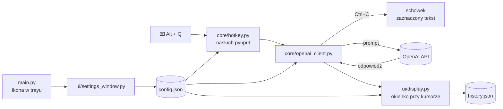

# AutoExplain – wyjaśnianie zaznaczonego tekstu przez AI

Aplikacja działająca w tle (ikona w zasobniku systemowym Windows). Zaznaczasz dowolny tekst, np. w PDF-ie, przeglądarce lub IDE, wciskasz `Alt + Q`, a obok kursora pojawia się okienko z krótkim wyjaśnieniem od modelu OpenAI. W tym samym okienku można dopytać o szczegóły, z kontekstem poprzedniej odpowiedzi albo bez niego.

<!-- Tu wstaw zrzut ekranu okienka z odpowiedzią: docs/demo.png -->
<!--  -->

## Funkcje

- **Globalne skróty klawiszowe** działające w każdej aplikacji (`pynput`):
  - `Alt + Q` – wyjaśnij zaznaczony tekst,
  - `Alt + A` – zamknij okienko,
  - `Alt + P` – zamknij aplikację.
- **Okienko przy kursorze:** bez ramki systemowej, zawsze na wierzchu, można je przesuwać. Samo dopasowuje pozycję do krawędzi ekranu.
- **Dopytywanie:** pole „Zadaj pytanie…”, a przycisk 🔗 dołącza poprzednią odpowiedź jako kontekst.
- **Historia:** wszystkie wyjaśnienia są zapisywane lokalnie (`history.json`). Strzałką ← cofasz się do poprzednich.
- **Ustawienia z GUI:** kolory, skróty klawiszowe i instrukcja systemowa dla modelu (zapis do `config.json`).
- **Wielowątkowość:** nasłuch skrótów, zapytania do API i okno GUI działają w osobnych wątkach, więc aplikacja nie blokuje systemu.

## Technologie

Python · OpenAI API (`gpt-4o-mini`) · CustomTkinter · pystray · pynput · pyperclip · PyAutoGUI

## Architektura



## Instalacja

```bash
git clone https://github.com/wikad/LearningAiAssistant.git
cd LearningAiAssistant
python -m venv .venv
.venv\Scripts\activate
pip install -r requirements.txt
copy .env.example .env      # wpisz swój OPENAI_API_KEY
python main.py
```

Aplikacja pojawia się jako ikona w zasobniku systemowym. Prawy przycisk otwiera menu **Ustawienia** i **Zamknij**.

## Struktura

```
LearningAiAssistant/
├── main.py                 # ikona w trayu, start wątku skrótów
├── config.json             # skróty, kolory, prompt systemowy
├── core/
│   ├── hotkey.py           # wykrywanie kombinacji klawiszy
│   └── openai_client.py    # pobranie zaznaczenia + zapytanie do API
├── ui/
│   ├── display.py          # okienko z odpowiedzią i dopytywaniem
│   └── settings_window.py  # okno ustawień
├── utils/
│   ├── config_manager.py   # parsowanie skrótów z config.json
│   ├── history_manager.py  # zapis historii
│   └── paths.py            # ścieżki względem katalogu projektu
└── assets/icon.png
```

## Plany

- obsługa innych modeli (np. lokalnie przez Ollamę),
- przełączanie trybów: „wyjaśnij”, „przetłumacz”, „streść”,
- zmiana skrótów bez restartu aplikacji.
